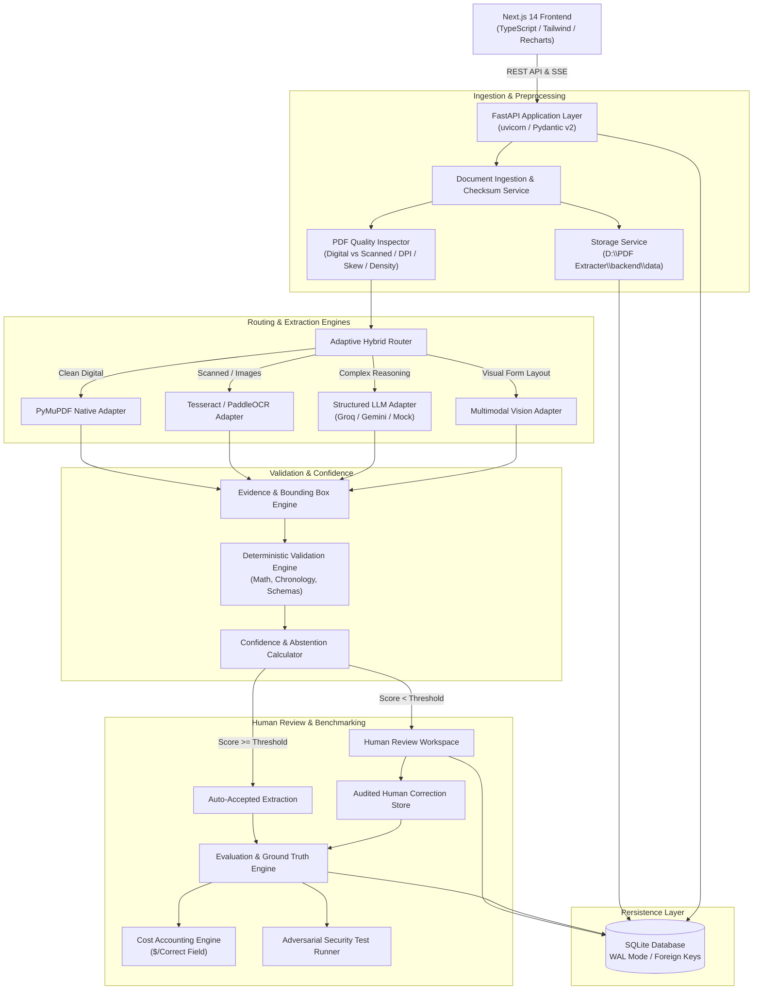

# ARCHITECTURE & SYSTEM DESIGN
## Insurance Document Intelligence Lab

### 1. Architectural Layers & Separation of Concerns

1. **Presentation Layer (Frontend)**:
   - Next.js 14 App Router, TypeScript, Tailwind CSS, Lucide Icons, Recharts.
   - 11 dedicated, functional views: Overview, Documents, Processing Queue, Human Review, Extraction Lab, Experiments, Evaluation, Cost Analysis, Datasets, Security Tests, Settings.
   - Dual-pane Document Detail with integrated SVG bounding-box highlights linked directly to field cards.

2. **API & Orchestration Layer (Backend)**:
   - FastAPI 0.140 with Pydantic v2 models.
   - Durable asynchronous job processing with in-memory worker backing transactional state machine: `QUEUED -> PROCESSING -> EXTRACTING -> VALIDATING -> COMPLETED / REVIEW_REQUIRED / FAILED`.
   - Comprehensive error envelopes, correlation IDs, and streaming events.

3. **Inspection & Classification Subsystem**:
   - `PDFInspector`: Analyzes page-by-page character count, font metadata, vector drawing presence, image coverage ratio, DPI, and page rotation.
   - Quality categorization: `HIGH_DIGITAL`, `MIXED_DIGITAL_IMAGE`, `CLEAN_SCAN`, `DEGRADED_SCAN`.

4. **Multi-Engine Extraction Architecture**:
   - Unified `BaseExtractionAdapter` abstract base class defining `extract(document, pages, schema, options) -> ExtractionResult`.
   - `NativePyMuPDFAdapter`: Extracts text blocks, lines, spans, bounding rectangles, reading order, and table grids with zero external API calls.
   - `TesseractAdapter` & `PaddleOCRAdapter`: Robust capability checks, preprocessing (grayscale, Otsu thresholding, deskewing), with real capability exception handling when binaries are absent.
   - `LLMAdapter` & `MultimodalAdapter`: Provider-agnostic client supporting structured JSON schemas with full token/cost accounting.
   - `HybridRouter`: Combines page-level quality indicators to route pages/fields to the optimal engine, maximizing accuracy while minimizing token cost.

5. **Validation & Confidence Subsystem**:
   - Rule engine verifying required types, date formats, ISO currencies, arithmetic consistency (Subtotal + Tax - Discount = Total), and temporal logic (e.g. incident_date <= filing_date <= policy_expiration_date).
   - Multi-signal confidence calculation: OCR character confidence + format adherence + cross-field validation passed + cross-method consensus.

6. **Human Review & Ground Truth Subsystem**:
   - Implements non-destructive corrections: machine extraction remains pristine while human edits are versioned in an audit log.
   - Ground truth management supports Gold Standard datasets, annotation conflict detection, and held-out test splits.

7. **Cost Accounting Subsystem**:
   - Tracks input/output tokens, vision image units, CPU time, and reviewer human time (at configurable $/hr).
   - Computes machine-only cost vs fully-loaded cost, computing the definitive metric: **Cost per Correct Field ($/CF)**.

